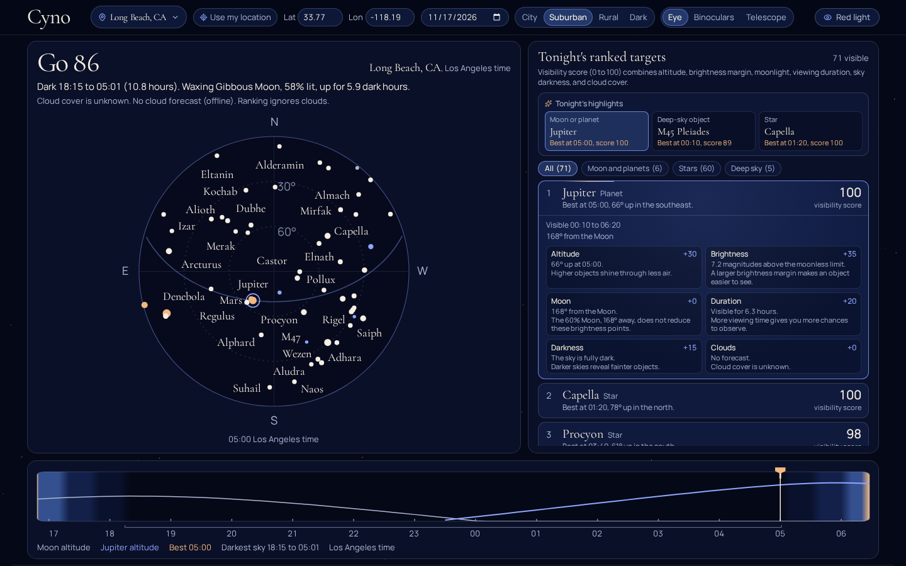
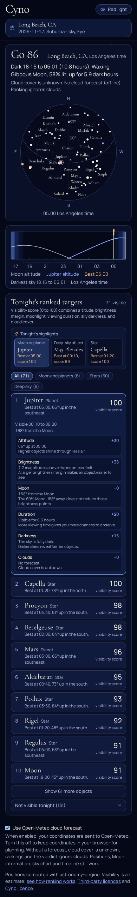
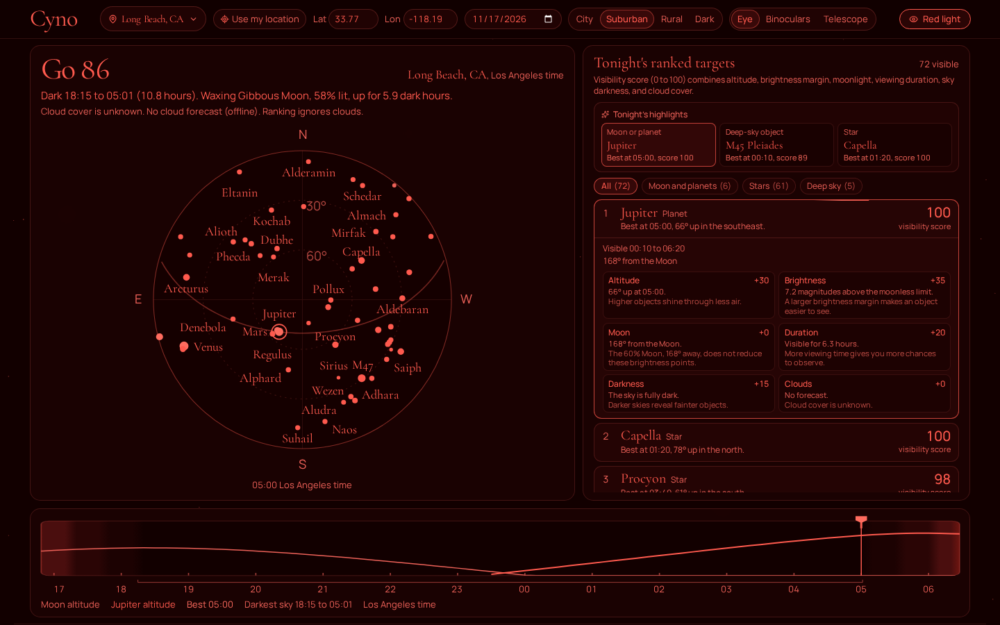
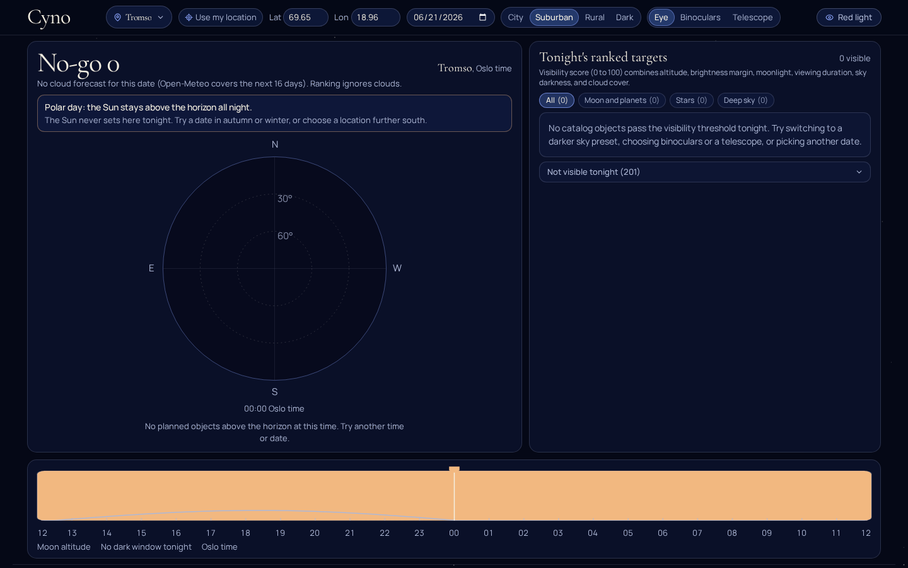

# Cyno

Design notes for an agentic astronomy assistant - a companion that answers
space questions, plans stargazing around your location and the weather, and
tells you when something worth looking at is about to happen.

> **Milestone 1 is built: what can I see tonight.** Try it at https://bananatruck.github.io/Cyno/
> Give it a latitude, longitude and date, and it returns a ranked list of the objects you can actually see, with the reasoning for every rank, a sky chart and a night timeline.
> It runs entirely in the browser with no keys, no server and no model calls.
> The conversational assistant, notifications and everything else in the plans below are not built yet.



| Phone                                                          | Red-Light Mode                                                     | A night with no dark sky                                                   |
| -------------------------------------------------------------- | ------------------------------------------------------------------ | -------------------------------------------------------------------------- |
|  |  |  |

The desktop, phone and Red-Light screenshots show Long Beach, CA on 2026-11-17, and the third table image shows Tromso on 2026-06-21.
The browser test takes them with the cloud forecast blocked, so they show computed data only.
The app is live at **https://bananatruck.github.io/Cyno/**, deployed from `main` by the Pages workflow.

## What is here

| Path              | What it is                                                                           |
| ----------------- | ------------------------------------------------------------------------------------ |
| `packages/engine` | The observability engine: pure TypeScript, offline, tested against USNO and JPL data |
| `apps/web`        | The web app: sky chart, night timeline, ranked list with reasoning                   |
| `docs/SPEC.md`    | The milestone 1 spec, including the exact ranking formula                            |
| `design/`         | The design plan and the mock-ups the UI was built from                               |
| `GPTPlan.md`      | An architecture plan drafted with GPT                                                |
| `GeminiPlan.md`   | The same problem planned with Gemini, kept for comparison                            |

Keeping both plans was the point of the repo before any code existed: two models
were given the same brief, and the plans differ in how they split the agent loop
from the data layer.

## The idea

An assistant that is useful specifically because it knows _where and when_ you
are:

- Answer astronomy questions conversationally rather than as search results.
- Given a location and a date, say what is actually observable - accounting for
  moon phase, cloud cover and light pollution, not just what is above the
  horizon.
- Notify ahead of eclipses, meteor showers, oppositions and ISS passes.
- Explain what you are looking at once you have found it.

The parts that would need real work are the observability calculation and the
notification scheduling. The conversational layer is the easy half, which is
roughly the opposite of how the previous README presented it.

## If this gets picked up

The first milestone worth building is narrow: take a latitude, longitude and
date, and return a ranked list of observable objects with the reasoning shown.
That is testable without any model in the loop, and everything conversational
can sit on top of it later.

No dates are promised here. The previous roadmap committed to a beta that never
happened, which is worse than committing to nothing.

## Run it

You need Node 22.22.2 or newer on the 22 line (or 24.15+, or 26+) and pnpm 10.

```sh
pnpm install
pnpm dev
```

Then open the address Vite prints (usually http://localhost:5173).
`pnpm check` runs the format check, lint, type-check, all tests and the production build.
`pnpm --filter @cyno/web e2e` runs the browser tests and refreshes the screenshots; the first time, install the browser with `pnpm --filter @cyno/web exec playwright install chromium`.

## Deploy

`.github/workflows/pages.yml` builds `apps/web` and publishes it to GitHub Pages on every push to `main`.
Pages must use GitHub Actions as its source before the first run: Settings, Pages, Source, GitHub Actions, or `gh api -X POST repos/bananatruck/Cyno/pages -f build_type=workflow` when no Pages site exists yet (use `-X PUT` with the same field to switch an existing site to GitHub Actions).
The build uses relative asset paths, so the same output works at the root of a domain and under `/Cyno/`.

## Using the app

- Pick a place from the presets, use your location, or type latitude and longitude, then pick the date, your sky (city to dark site) and what you observe with (eye, binoculars, telescope).
- The verdict line says Go, Marginal or No-Go for the night, with the dark window and the Moon.
- The sky chart is the dome above you at the selected time: zenith in the centre, horizon at the rim, north at the top and east on the left, as seen looking up. Select any object to see its path through the night.
- The night timeline is painted in the sky's real colour from sunset to sunrise, with the Moon's altitude, the selected object's altitude, cloud bars when there is a forecast, and a scrubber that moves the chart.
- The ranked list shows each object's visibility score; open one to see the six factors with their points. Highlights pick the best Moon or planet, deep-sky object and star; filters narrow the list by kind.
- "Not visible tonight" lists every catalog object that did not make it, with the reason.
- Red-Light Mode turns the whole interface deep red to protect night vision, and is remembered in your browser.
- The address bar always holds the place, date, sky and equipment, so a plan can be shared as a link.
- Once the page has loaded, every calculation runs in the browser with no network; only the optional cloud forecast needs a connection. Loading the page itself needs a connection, as there is no offline install yet. Without a forecast the app says so and ranks without clouds instead of assuming a clear sky. One exception: after the page goes offline, a retry following a failed calculation worker has to fetch the worker (or, after a second failure, the main-thread fallback) again, and that fails if the browser has not cached it.

## How the ranking works

Every number below is in `docs/SPEC.md`, and the engine's tests check the formula on real output.

**Positions are computed, not looked up.**
The Sun, Moon and planets come from [astronomy-engine](https://github.com/cosinekitty/astronomy), which its author validates against JPL Horizons and NOVAS.
Stars and Messier objects come from published catalogs and are rotated to your horizon with the same library.
Altitudes are geometric, without atmospheric refraction.

**The night runs from local noon to local noon.**
The engine samples it every 10 minutes and labels each sample by the Sun's altitude: day, civil twilight (down to -6 degrees), nautical twilight (-12), astronomical twilight (-18) and night.
The dark window is the longest stretch at the darkest level reached.
Polar day, polar night and summer nights that never get fully dark are normal results with their own explanation, not errors.

**Visibility is an estimate from a sky-brightness model.**
The sky's brightness is the sum of three sources: light pollution (a preset from city to dark site), twilight, and moonlight at the object's position from the Krisciunas and Schaefer (1991) model.
That brightness sets a limiting magnitude, raised by a fixed amount for binoculars or a telescope.
An object's magnitude is dimmed by the air it shines through (using the paper's air mass for directly observed objects, which reaches 40 at the horizon) and, for galaxies and nebulae, by a penalty for being spread out.
The difference is the margin: an object is visible when it is at least 10 degrees up, the Sun is below -0.833 degrees, the margin is zero or more, and clouds (when a forecast is available) are under 80 percent.
The best moment is the visible sample with the largest margin.

**The visibility score adds six visible parts.**

| Factor     | Points    | Rule                                                                       |
| ---------- | --------- | -------------------------------------------------------------------------- |
| Altitude   | 0 to 30   | Full points at 60 degrees or higher at the best moment                     |
| Brightness | 0 to 35   | Margin without the Moon, full points at 5 magnitudes                       |
| Moon       | 0 or less | What moonlight takes away from the brightness points                       |
| Duration   | 0 to 20   | Hours visible tonight, full points at 4 hours                              |
| Darkness   | 2 to 15   | How dark the sky is at the best moment                                     |
| Clouds     | 0 or less | The other five times the forecast cloud cover; 0 when there is no forecast |

The parts always add up to the score, so every rank can be checked by hand.
The score measures how well you can see an object tonight, not how interesting it is, which is why bright stars rank high; the app's filters and highlights help with the second question.

**The Go/No-Go verdict** weighs hours of real darkness (40 points), how much of that time a bright Moon is up (30) and the forecast cloud cover (30, left out and rescaled when there is no forecast).
A night is always No-Go when the forecast covers at least half of the dark hours and averages 80 percent cloud or more over the part it covers, or when nothing at all is visible.

## How correctness is checked

The engine tests compare against published data stored unmodified in `packages/engine/test/fixtures/raw/`, retrieved on 2026-11-17:

- USNO sunrise, sunset, civil twilight, moonrise and Moon illumination for Long Beach on 2026-11-17, within 1 minute (2 for the Moon).
- USNO polar night and midnight sun for Tromso on 2026-12-21 and 2026-06-21.
- All 50 USNO Moon phase times of 2026, within 2 minutes.
- JPL Horizons (DE441) azimuth and altitude of the Sun, Moon, Venus, Mars, Jupiter and Saturn, within 0.1 degree.
- JPL Horizons' minute-by-minute Sun altitude for nautical and astronomical dusk, within 1 minute.

Where no published value exists, the tests check invariants instead: scores equal the sum of their factors, more moonlight never helps, better equipment never hides an object, and every hidden object has a reason.

## Data sources

- Stars: the [IAU Catalog of Star Names](https://www.pas.rochester.edu/~emamajek/WGSN/IAU-CSN.txt), named stars brighter than magnitude 2.5.
- Messier objects: [OpenNGC](https://github.com/mattiaverga/OpenNGC) by Mattia Verga (CC BY-SA 4.0), with globular cluster magnitudes that OpenNGC lacks taken from the [Harris catalog](https://physics.mcmaster.ca/~harris/mwgc.dat). M35, which neither gives a magnitude for, takes V 5.1 from NGC 2000.0 as served by [NASA HEASARC](https://heasarc.gsfc.nasa.gov/W3Browse/all/ngc2000.html). M102 is left out because it has no agreed identification (OpenNGC files it under M101), which leaves 109 of the 110.
- Cloud cover: [Open-Meteo](https://open-meteo.com/), free and keyless, fetched by the browser and optional.

`packages/engine/scripts/build-catalog.py` downloads the sources and regenerates `catalog.json`; the generated file is not edited by hand.

## What is next

Milestone 1 is the observability core the original plans said everything else should sit on.
The natural next steps, roughly in order:

- A multi-night planner: run the same engine across a week or a month and pick the best nights, which is the "suggest when to stargaze this week" idea in `GPTPlan.md`.
- Events: meteor showers, eclipses, oppositions and conjunctions from the same ephemeris, then ISS passes, which need orbital elements from an outside source.
- Notifications ahead of those events, which is where scheduling becomes the hard part the README already predicted.
- The conversational layer on top, calling the engine as a tool, so answers about tonight's sky are computed rather than generated.
- A light pollution map instead of the four sky presets.

## License

MIT for Cyno's own code.
Some adapted UI components and the catalog data keep their own terms: React Bits (MIT + Commons Clause), Aceternity UI (its own licence, not MIT) and OpenNGC (CC BY-SA 4.0).
The details and notices are in [THIRD_PARTY_NOTICES.md](THIRD_PARTY_NOTICES.md).
